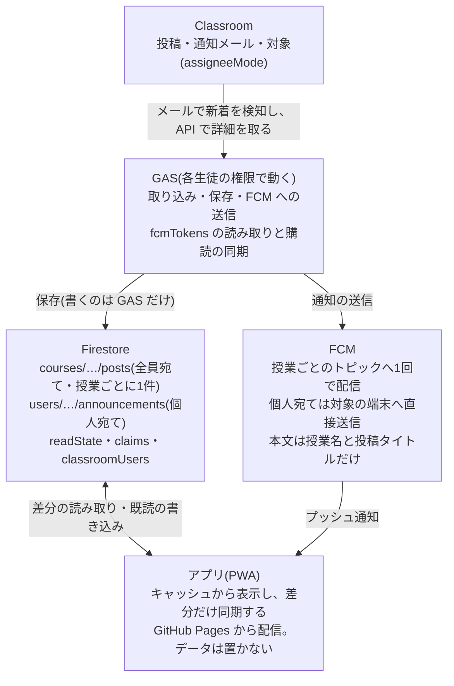

# BenriApp 通知の仕様(改訂版)

2026-11-03

## 目的と範囲

Classroom の投稿を、授業のメンバーに1回だけ通知し、アプリで一覧できるようにする。通知と保存の経路は Google のサービス(Classroom・Firestore・FCM)に限り、第三者の通知サービスは使わない。

- 全員宛ての投稿は授業ごとに1件だけ保存し、個人宛ては対象の生徒の領域にだけ保存する。
- 無料の Spark プランの上限(1日: 読み取り5万・書き込み2万・削除2万)に収める。
- 含む: 投稿の取り込み、保存、FCM 通知、表示と同期、既読、リマインド、古いデータの削除、セキュリティルール、移行、OneSignal の停止、PaddleOCR の先読み(付録)。
- 含まない: 時間割の読み取り精度の改善、お知らせ以外の機能、学校側の運用ルール。

前提の規模は、最大800人、1人あたり約10授業、1日のお知らせは平均5件(日によって±5件)。

## 決定事項

1. 通知基盤は OneSignal をやめ、FCM(HTTP v1)にする。会議で決定した。
2. お知らせは生徒ごとではなく授業ごとに保存し、その授業のメンバーに表示する。Firebase の無料枠を超えないための変更。
3. 個人宛ては Classroom API の assigneeMode で判別し、Classroom ユーザー ID と生徒 ID の対応表で保存先を決める。
4. 取得は各生徒の GAS が自分の権限で行う。それ以上の権限は使えない。
5. 既読・未読のデータは、利用者側(個人の領域)に持つ。
6. 通知は、見出しを授業名、本文を投稿タイトルのみにする。
7. Firestore の TTL は無料プランで使えないため、GAS のクリーンアップで代用する。
8. 既存の users/\*/announcements は授業単位に統合して移行する。同じ授業で重複しているため、差分があれば統合する。
9. PaddleOCR の初回ダウンロードは、通常時にバックグラウンドで済ませる(付録)。
10. 通知の許可は、説明画面を出し、利用者がボタンを押したときに求める。ページを開いた時点では自動で出さない。許可がない端末には、既存の「通知を直す」を出す。iPhone は、ホーム画面から開いたときだけ許可を求められる。
11. 編集された投稿は再通知しない。画面の表示だけを更新する。
12. お知らせの保存期間は14日とする。iPhone の案内は、現状の案内のままにする。
13. 1人分のお知らせは、初回に新しい30件を取り、そのあとは画面をスクロールしたときに20件ずつ取る。毎日の全件の取り直しはしない(無料枠の節を参照)。
14. link が無く postKey を作れない過去のお知らせは、移行のときに捨てる(残さない)。

## 全体構成

全員宛ては授業ごとに1件、個人宛ては本人の領域に保存する。アプリは Firestore を購読せず、通知と差分の読み取りで更新する。「Google のサービス内で完結する」とは、通知の配信と保存の経路が Google のサービスに限られるという意味で、アプリの画面は GitHub Pages から配信される。

## データ構造

全員宛ては授業側に1件だけ、個人宛てと既読は本人の領域に置く。読む権限と書く権限は、次の表のとおり分ける。

| 場所 | 中身 | 読める人 | 書く人 |
| --- | --- | --- | --- |
| courses/{授業ID}/posts/{投稿ID} | 全員宛ての投稿(本文・添付・期限・updatedAt・deleted・expireAt) | その授業のメンバー | GAS |
| courses/{授業ID}/members/{生徒ID} | 授業のメンバー(joinedAt) | クライアントは不可 | GAS |
| claims/{投稿鍵} | 排他ロック(claimedBy・claimedAtMs・sentAtMs・expireAt)。現行の最上位 posts を改名 | GAS のみ | GAS |
| users/{生徒ID}/announcements/{投稿ID} | 個人宛ての投稿 | 本人 | GAS |
| users/{生徒ID}/readState/main | reads(投稿ID→既読時刻)と flags(送信済みの印) | 本人 | reads は本人、flags は GAS |
| users/{生徒ID} | schoolEmail・name・notifyPrefs | 本人 | notifyPrefs は本人、ほかは GAS |
| users/{生徒ID}/fcmTokens/{ハッシュ} | token・updatedAt（端末の登録トークン、1端末1件） | 本人（読み書き・削除） | 本人がアプリから書く。書けるのは token と updatedAt だけ。GAS は読む |
| classroomUsers/{ClassroomユーザーID} | 生徒ID(対応表) | GAS のみ | GAS |

旧構造(users/{生徒ID}/announcements に全員分を書く方式)との違いは、全員宛てを授業側の1件にまとめる点と、既読・リマインドの印を投稿から切り離して readState に移す点。投稿鍵 postKey は、投稿のリンクから作る「授業ID.種類.投稿ID」で、全員で同じ値になる。

## 投稿の取り込み(GAS)

新着の検知は現行どおり、各生徒の GAS が Gmail の Classroom 通知メールで行い、詳細は Classroom API で取る。各生徒の権限で動くため、取得できるのは本人が見える投稿だけになる。

1. 通知メールのリンクから授業 ID と投稿 ID を取り出し、全員で同じになる投稿鍵 postKey を作る(現行の parsePostLink\_)。
2. Classroom API で投稿を取得し、assigneeMode で振り分ける。
    - ALL\_STUDENTS(全員宛て): claims/{postKey} を新規作成できた1人だけが、courses/{授業ID}/posts/{投稿ID} に書き、授業のトピックへ通知する。ほかの人は書かない。
    - INDIVIDUAL\_STUDENTS(個人宛て): individualStudentsOptions.studentIds(Classroom ユーザー ID)を対応表で生徒 ID に変え、その生徒の users/{生徒ID}/announcements/{投稿ID} にだけ書く。通知もその生徒の端末にだけ送る。
3. 送る役が2分たっても終わらないときは、ほかの人が引き継ぐ(現行の stale 判定を残す)。
4. 所属授業は Courses.list(studentId: me)で取り、メールの到着を待たずに members へ反映する。
5. 本人の Classroom ユーザー ID は、連携時に UserProfiles.get(me) で classroomUsers に登録する。
6. 対応表にない Classroom ユーザー ID は、保存も通知もせず、記録に残して後で確認する。
7. お知らせ(p)にはタイトルが無いため、本文の1行目を切り出して投稿タイトルにする(現行のメール解析と同じ)。

## 通知(FCM)

通知は GAS から FCM の HTTP v1 API で送る。全員宛ては授業ごとのトピックへ1回、個人宛ては対象の端末へ直接送る。

- 認証は既存の FIREBASE\_SERVICE\_ACCOUNT で OAuth トークンを作る(FCM 用のスコープを追加)。Cloud Functions は使わず、Spark で足りる。
- 見出しは授業名、本文は投稿タイトルのみ。投稿の本文と添付は通知に入れない。
- 通知のデータに、投稿 ID・種類(全員宛て/個人宛て)・授業 ID を入れる。タップしたら、その1件だけを読む。
- トークンの登録は、アプリが GAS の Web アプリ(ログインと同じ仕組み)を呼んで行う。GAS が Firestore に保存し、その生徒の所属授業のトピックに購読させる。
- トピック購読は、GAS から FCM の v1 REST API で行う。
    - 購読: `POST https://fcm.googleapis.com/v1/projects/{PROJECT_ID}/registrations/{REGISTRATION_ID}/topicSubscriptions?topic_name={TOPIC_NAME}`(本文は `{}`)
    - 解除: `DELETE https://fcm.googleapis.com/v1/projects/{PROJECT_ID}/registrations/{REGISTRATION_ID}/topicSubscriptions/{TOPIC_NAME}`
    - 1回の呼び出しは、1つの登録トークンを1つのトピックに入れる。まとめて入れる一括の上限(1,000台)は Admin SDK の話で、REST には当てはまらない。
    - Authorization は OAuth2 のアクセストークン(サービスアカウントの JWT から取得)。
    - REGISTRATION_ID は、アプリから受け取った FCM の登録トークン。
- 旧 Instance ID API(iid.googleapis.com の batchAdd)は非推奨で、2027年9月29日に削除される。使わない。
- 同じ購読が既にあると HTTP 409 が返る。再登録時はこれを正常として扱う。
- 授業ごとの通知オフ(notifyPrefs.offCourses)は、その授業のトピックの購読解除で実現する。設定を変えたとき、アプリが GAS に購読の同期を頼む。
- トピック送信は、端末ごとの成否が返らない。トークンの生存確認は、アプリの起動時に更新時刻を書き、一定期間(仮に60日)更新のないものを GAS が掃除する。「通知を直す」画面は、再登録だけの簡単なものにする。
- 通知の許可がない端末と、購読が切れた端末には届かない。取りこぼしは、アプリを開いたときの同期で補う。
- iPhone は、ホーム画面に追加したアプリでないと通知が届かない(現行と同じ)。

## アプリの表示と同期

起動時は端末のキャッシュから先に表示し、Firestore の購読(onSnapshot)は張らない。差分は、投稿の更新時刻 updatedAt が前回の同期より新しいものだけを取る。

- 同期のきっかけは3つ。(a) 通知を受けたとき、通知された1件を ID で読む。(b) 前回から数時間以上たった起動時に、全体の差分を取る。(c) 手動の引き下げ更新。
- 全体の差分は2系統で取る。所属授業の全員宛て投稿と、自分の個人宛て投稿(users/{自分}/announcements)。
- 全員宛ての差分は、collection group クエリ1本(courseId in 所属授業、30件まで、updatedAt が前回より新しい)にまとめるのを第一案とする。空の結果でも1回と数えるため、授業ごとに10本投げると1回の同期で10回になる。複合インデックス(collection group)が必要。
- 上のクエリがセキュリティルール(メンバー確認)と両立するかは、エミュレータで要検証。両立しないときは、(a)を中心にし、全体の差分は1日2回程度にする。
- updatedAt で取るので、編集と、削除の印(deleted)も端末に届く。
- キャッシュは、Firestore の永続キャッシュ(IndexedDB)と localStorage。直近のお知らせは localStorage にも保存する(本文は保存しない。現行の仕組みを維持)。キャッシュは利用者の端末の中だけに残る。

## 既読とリマインド

既読は生徒1人につき1ドキュメント(users/{生徒ID}/readState/main)に、投稿 ID と既読時刻の対応として持つ。投稿ごとにドキュメントを作らないので、リマインドの読み取りが生徒数ぶんの batchGet で済む。

- 本人が書けるのは reads だけ。送信済みの印(期限リマインド済み・未読再通知済み)は、GAS だけが flags に書く。
- 既読の書き込みは、数秒ぶんをまとめて1回にする。「まとめて既読」も1回で書く。
- 投稿が消える日に合わせて、GAS のクリーンアップが、その投稿 ID の項目を reads と flags から取り除く。ドキュメントの肥大を防ぐ。
- 期限リマインド(18時以降、設定した日数前)と未読再通知(設定した時間後)は、毎時ではなく1日2〜3回にする。1回の実行で、直近14日の投稿と、対象生徒の readState を batchGet(100件ずつ)で突き合わせる。
- 実行する役は、claims/reminder-日付-枠 の排他ロックで1人に決める。全員の GAS が同じ処理を重ねて走らせない。
- 各生徒の GAS が自分の分を毎時に読む方式は、読み取りが多すぎるので使わない。
- 授業ごとの通知オフと、リマインドの設定は、現行の notifyPrefs をそのまま使う。

## 投稿の変更と削除

編集と削除はメールが届かないため、授業ごとに1人が定期的に点検して検知する。

- 点検役は、claims/recheck-授業ID-枠 の排他ロックを取った1人。直近14日の投稿を、Classroom API の updateTime と保存済みの値で比べる。頻度は1日数回から始める。
- 内容が変わったら、courses/.../posts を更新して updatedAt を進める。端末は、差分の同期でその変更を受け取る。
- 対象が変わったとき(全員宛てと個人宛ての入れ替わり)は、古い保存先を非表示にし、新しい保存先に保存して、必要な人に通知する。
- 削除は、保存先にすぐ消さず、deleted を true にして updatedAt を進める。端末が差分で削除を知れるようにするため。実際の削除は、expireAt を過ぎてからクリーンアップが行う。
- 投稿が見つからない(404)ときは、削除済みとみなす(現行の fetchPost\_ と同じ判定)。

## 古いデータの削除(TTL の代替)

無料プランでは Firestore の TTL が使えないため、GAS のクリーンアップ(毎日3時、現行の cleanupExpiredPosts)を拡張して代用する。

- 対象は、courses/\*/posts と users/\*/announcements の expireAt が過去のもの、claims、readState の古い項目。
- expireAt は作成時に、保存期間ぶん先の日時を入れる。保存期間は未決(目安は14日)。
- courses/\*/posts と users/\*/announcements は collection group クエリで探すため、expireAt のインデックス(collection group)を有効にする。
- 現行のクリーンアップは、最上位の posts だけを消している。同名の衝突を避けるため、排他ロック用は claims に改名する。
- 1回の実行の件数上限(現行の CLEANUP\_MAX\_ROUNDS)を維持し、1日の削除2万回の枠に収める。
- readState の項目の取り除きは更新であり、削除の枠には数えない。

## セキュリティルール

読めるのは本人かその授業のメンバーだけにし、書き込みは GAS(サービスアカウントはルールを素通りする)に限る。例外は、本人の既読と通知設定だけ。

- courses/{授業ID}/posts: その授業のメンバーだけが読める。メンバーかどうかは、courses/{授業ID}/members/{uid} の存在で判定する。
- courses/{授業ID}/members: クライアントからは読めない。生徒 ID に学年と番号が含まれるため、クラスメイトに見せない。ルールの exists() は、読み取りを禁止していても使える。
- users/{生徒ID}/announcements: 本人だけが読める。
- users/{生徒ID}/readState: 本人だけが読め、本人が書けるのは reads だけ。
- users/{生徒ID}: 本人だけが読め、本人が書けるのは notifyPrefs だけ。
- claims、classroomUsers: クライアントからはすべて拒否する。
- ルール内の exists() と get() も、読み取りとして数えられる。
- 移行前にエミュレータで、他人の個人宛てと、所属していない授業の投稿が読めないことを確かめる。

## 個人情報と同意

授業の内容は、Google のサービス(Classroom、Firestore、FCM)の中だけで扱い、通知に含めるのは授業名と投稿タイトルまでにする。

- Classroom ユーザー ID を対応表に保存する。学校に相談し、利用者に説明したうえで行う。承認が下りるまで、個人宛ての保存は有効にしない。
- 利用者への説明文の案は、「通知の配信と保存に Google のサービスを使います。通知に含まれるのは授業名と投稿のタイトルだけで、本文は含まれません。」
- 投稿タイトルは、端末のロック画面にも表示される。本人以外に見える可能性があることを、利用者に案内する。
- 「第三者から取得されない」とは保証しない。Google のサービスの契約と、その中の管理に依存する。
- 時間割読み取り(PaddleOCR)の部品とモデルは、現在は第三者の CDN から取っている。自前配置に切り替える(付録)。

## 無料枠の見積もり

Spark の無料枠に収まる見込み。ただし余裕は、読み取りより書き込みの方が薄い。前提は、800人、1人10授業、1日5件(忙しい日は10件)、同期は1人1日約5回。

| 項目(1日) | 通常 | 忙しい日 | 無料枠 |
| --- | --- | --- | --- |
| 読み取り | 約17,000 | 約25,000 | 50,000 |
| 書き込み | 約9,000 | 約14,000 | 20,000 |
| 削除 | 1日の投稿数程度 | 同左 | 20,000 |

- 読み取りの内訳(通常、同期クエリを1本にした場合): 新着4,000、同期クエリ4,000、排他ロックの試行4,000、リマインド4,500。
- 同期クエリを授業ごとに10本にすると、同期クエリだけで約40,000になる。1本にまとめることが前提。
- 書き込みの最大項目は既読(通常4,000、忙しい日8,000)。まとめ書きで減らす。
- ルールの exists() ぶんの読み取りは含まない。数千回の上乗せを見込む。
- 上限に達すると、その日は読み書きが止まり、取り込みも止まる。上限に近い日が続くなら、予算の上限を設定した Blaze(無料枠は同じで、超過分だけ課金)に切り替える。
- 移行後の2週間は、Firebase コンソールの使用量を毎日確認し、見積もりとのずれを見る。

## 1人分のお知らせの取り方(無料枠の見積もり)

1人が手元に持つ件数は100件とする。ただし、読み取りはその件数に比例するため、毎日すべてを取り直すと無料枠を超える。前提は、800人、1人10授業、1日5件、同期は1日5回。

| 取り方 | 1人あたりの読み取り(1日) | 800人の合計 | 無料枠(50,000) |
| --- | --- | --- | --- |
| 差分のみ、授業ごとに10本の検索 | 5件 + 空の検索10本 × 5回 = 55 | 約44,000 | 収まる(余裕は少ない) |
| 差分のみ、検索を1本にまとめる | 5件 + 5回 = 10 | 約8,000 | 収まる |
| 毎回100件を取り直す | 100 × 5回 = 500 | 約400,000 | 超過 |
| 1日1回だけ100件を取り直し、ほかは差分 | 100 + 4 = 104 | 約83,200 | 超過 |
| 初回だけ100件 | 100 | 約80,000 | 1日で超過 |
| 初回だけ30件 | 30 | 約24,000 | 収まる |

- 採用は、初回に新しい30件、そのあとは差分のみ、画面のスクロールで20件ずつ取る。
- 100件は、1日5件なら約20日分になる。保存期間の14日(約70件)より多いため、古い分は端末のキャッシュからも削除する。

## 移行計画

通知の文面から始め、OneSignal と FCM を並行させてから止める。既存データの統合は、無料枠に収まるよう数日に分けて行う。

1. 通知の文面を、授業名と投稿タイトルに変える(OneSignal のままで行える)。
2. INCLUDE\_LEGACY\_ID を false にする。生徒 ID で登録した端末が残っていないか確認してから行う。
3. 学校の承認を得て、各生徒が自分の Classroom ユーザー ID を classroomUsers に登録する。
4. FCM の送信とトークン登録を GAS に実装し、テスト用の端末で、トピックの購読・送受信・購読解除を確認する。
5. courses/.../posts と個人宛ての保存を、テスト用のデータで試す。セキュリティルールをエミュレータで検証する。
6. 既存の users/\*/announcements を、下記のルールで統合して courses/.../posts に移す。
7. 利用者に通知の再許可をお願いする(購読の仕組みが変わるため)。
8. 移行期間は、OneSignal と FCM の両方に送る。問題がなければ OneSignal を止める。
9. OneSignal の利用をやめ、アカウントに残るデータを削除する(方法は OneSignal のドキュメントで確認)。

既存のお知らせの統合ルール:

- 統合キーは、link から作る postKey。link が無く postKey を作れないものの扱いは未決。
- 同じ postKey の保存(生徒ごとに複数ある)は、1件にまとめる。差分があるときは、削除済み(deleted)があればそれを優先し、それ以外は本文(rawBody)が長く、添付が多いものを採る。receivedAt は最も古いものにする。
- 各生徒の既読(read・readAt)と、リマインド済みの印は、その生徒の readState に移す。
- 統合が確認できるまで、旧データは消さない。確認後に、旧データの全員宛て分を削除する。
- 旧データの読み取り・書き込み・削除は、1日の枠(5万・2万・2万)に収まるよう、数日に分ける。

## 付録: PaddleOCR の先読み

時間割読み取り(PaddleOCR)の初回ダウンロード(実行用の部品約28MB、モデル約20MB)を、OCR 画面を開く前に、通常時のバックグラウンドで済ませる。

- アプリの起動後、アイドル時間に取得して Cache Storage に保存する。requestIdleCallback が無い環境(Safari など)は、遅延実行で代用する。
- 条件は、ログイン済みで、従量課金でない接続で、データ節約がオフであること。navigator.storage.persist() を要求し、端末の容量不足で消されにくくする。
- iPhone では Background Fetch が使えないため、「アプリを開いている間の裏側」での取得になる。
- 現在の配信元は第三者の CDN(jsDelivr)。ファイルを GitHub Pages に自前で置き、同じ配信元から読む。先読みの前に行う。
- OCR 画面は、取得済みなら即時に始め、取得中なら進捗を出す。取得に失敗したときは、画面を開いたときに再試行する。
- スマホでの速度は未確認。実機で確かめる。

## テスト観点と受け入れ条件

テスト観点:

- 全員宛ての投稿が、授業のメンバーに1回だけ届き、保存も1件だけであること。
- 個人宛ての投稿が、対象の生徒にだけ届き、ほかの生徒の画面に出ないこと。
- 授業の通知をオフにした生徒に、その授業の通知が届かないこと。
- 投稿の対象が変わったとき、古い保存先が残らないこと。
- 編集と削除が、差分の同期で端末に届き、画面に反映されること。
- 通知をタップしたとき、1件だけを読むこと。
- 起動時に購読が張られず、同期の間隔が守られること。
- オフラインでも、前に読んだ内容が表示されること。
- セキュリティルールで、他人の個人宛て、所属していない授業の投稿、members が読めないこと。
- リマインドが、1日2〜3回の実行で重複せず、1人に1回だけ届くこと。
- 既存データの統合後に重複が残らず、既読が引き継がれていること。

受け入れ条件:

- 上のテスト観点がすべて通ること。
- 利用者への説明文と、学校向けの説明が、この仕様と一致していること。
- OneSignal への送信が止まっていること。
- Firebase の使用量が、無料枠の範囲で安定していること(移行後2週間の確認)。

## 未決事項

- Classroom ユーザー ID の保存についての学校の承認。2026-11-04 に「おけ」の回答を受けた。文面での確認は未。
- 同期の collection group クエリ1本と、メンバー確認のルールが両立するか(エミュレータで検証)。
- 1端末あたりのトピック数の上限(公式ページに数値なし)。授業数(1人約10)で足りるかを、実機で確認する。
- 購読の数の見積もり: 800人 × 約10授業 = 約8,000回の購読呼び出し(初回と授業の変更時のみ)。FCM API の呼び出しで、Firestore の無料枠には数えない。FCM 側の上限は公式で確認する。
- Web クライアントのトークンで、サーバー側の購読が通るか(テスト用端末で実機確認)。
- リマインドの実行回数と時刻(1日2〜3回)。
- トークンを掃除するまでの期間(仮に60日)。
